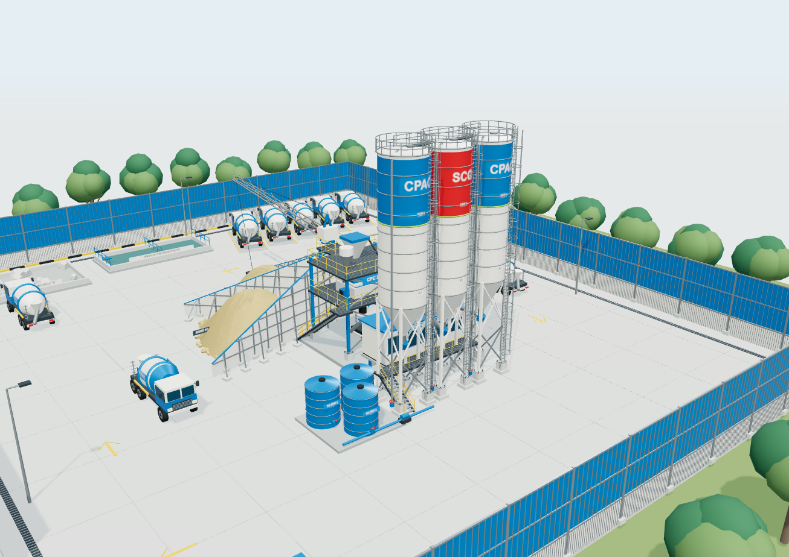

# CPAC Bangna KM 32 — โมเดลโรงงาน 3D

โมเดลโรงงานผลิตคอนกรีต บางนา กม.32 โครงการ PR69-024 สำหรับหมุน ซูม และสำรวจองค์ประกอบผ่านเบราว์เซอร์

**[เปิดโมเดล 3D](https://ammetroit-jpg.github.io/bangna-km32-3d/)** · **[ดาวน์โหลดโมเดล GLB](Bangna_32_Plant.glb)**

## วิธีใช้งาน

- ลากเมาส์ซ้ายเพื่อหมุน หมุนล้อเพื่อซูม และลากเมาส์ขวาเพื่อเลื่อน
- บนจอสัมผัส ใช้หนึ่งนิ้วหมุน และสองนิ้วเพื่อเลื่อนหรือซูม
- เลือกมุมมองภาพรวม ชุดผลิต ผังด้านบน หรือระดับสายตา
- เปิด–ปิดหมวดองค์ประกอบ เช่น ซ่อนรั้วเพื่อดูเครื่องจักรภายใน
- เปิด “ชื่อส่วนต่าง ๆ” แล้วคลิกป้ายเพื่ออ่านรายละเอียดและที่มาของข้อมูล
- ใช้ปุ่มบันทึกภาพ PNG หรือดาวน์โหลดไฟล์ GLB เพื่อนำไปใช้ในโปรแกรมที่รองรับ glTF 2.0

ไฟล์ `index.html` รวมตัวดู โมเดล วัสดุ และภาพอ้างอิงไว้ในไฟล์เดียว สามารถดาวน์โหลดแล้วเปิดแบบออฟไลน์ด้วย Chrome หรือ Edge ที่รองรับ WebGL ได้ หน่วยโมเดลคือเมตร แกน Y เป็นแกนตั้ง

## ที่มาและข้อสมมติ

- ใช้ **PDF เป็นข้อมูลหลัก**: ผังโครงการวันที่ 1 พฤศจิกายน 2026 และรูปตัดมาตรฐานที่รวมอยู่ในชุดเอกสาร
- พื้นที่ตามผัง 60 × 70 เมตร มีไซโล 180 ตัน **3 ใบ** แม้ภาพอ้างอิงสีและบรรยากาศจะแสดง 4 ใบ
- ความสูงไซโลประมาณ 20.40 เมตรอ้างอิงรูปตัดมาตรฐาน ตำแหน่งหรือรายละเอียดที่ไม่ระบุมิติใช้การถอดสัดส่วนและประมาณรูปทรง
- เครื่องมือที่ใช้ไม่สามารถอ่านเรขาคณิตจาก DWG ได้อย่างน่าเชื่อถือ จึงไม่นำผลการแปลง DWG มาใช้สร้างโมเดล
- สี วัสดุ รถ และสภาพแวดล้อมอ้างอิงภาพที่ผู้ใช้ให้มา รายละเอียดเครื่องจักร จุดต่อ ภายในอาคาร และภูมิทัศน์บางส่วนเป็นองค์ประกอบจำลอง
- โมเดลนี้ใช้สำรวจรูปทรงและการจัดวาง ยังไม่ใช่ BIM, shop drawing หรือ as-built ที่ตรวจสอบรายละเอียดทุกชิ้นส่วนแล้ว

อ่านข้อมูลมิติ แหล่งอ้างอิง และข้อจำกัดเพิ่มเติมใน [คำอธิบายภาษาไทย](README_ภาษาไทย.txt)

## ไฟล์

| ไฟล์ | รายละเอียด |
| --- | --- |
| [index.html](index.html) | ตัวดูโมเดลแบบโต้ตอบและออฟไลน์ |
| [Bangna_32_Plant.glb](Bangna_32_Plant.glb) | โมเดลพร้อมวัสดุและภาพป้ายที่ฝังในไฟล์ |
| [Bangna_32_Preview.png](Bangna_32_Preview.png) | ภาพเรนเดอร์จากโมเดล |
| [README_ภาษาไทย.txt](README_ภาษาไทย.txt) | วิธีใช้ รายละเอียดที่อ้างอิง และข้อสมมติ |
| [ThirdPartyNotices.txt](ThirdPartyNotices.txt) | ประกาศสิทธิ์ของไลบรารี Three.js |

ชุดเผยแพร่นี้ไม่รวมไฟล์แบบต้นฉบับ PDF และ DWG
